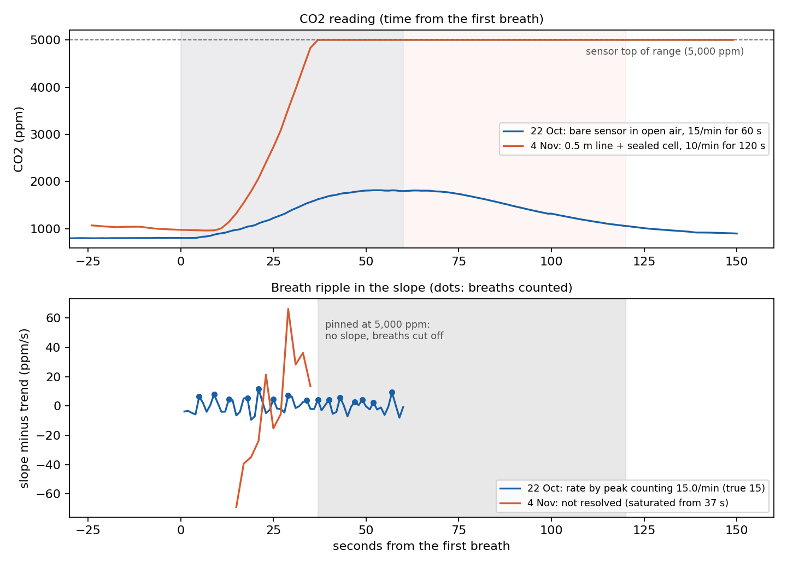
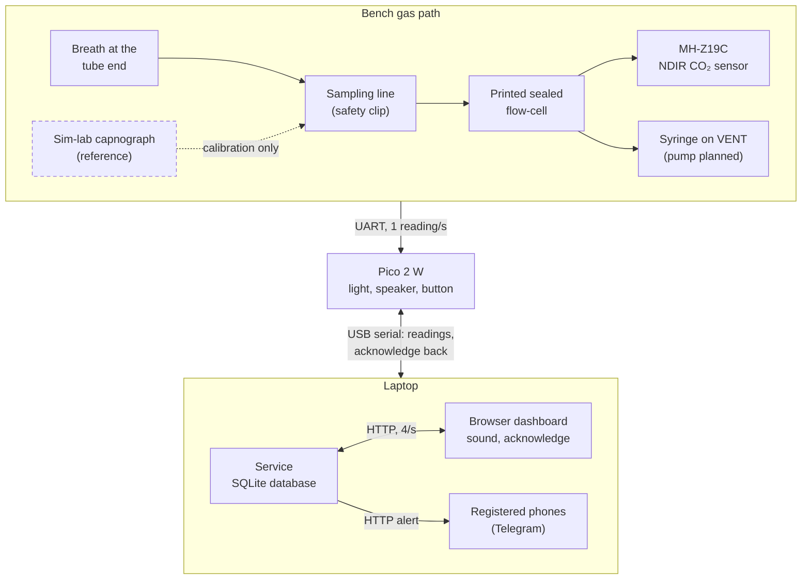

# Project 6: Is the Patient Ventilating?

**Exhaled CO₂ and hypoventilation monitor (bench prototype)**  
EXSU 620 Surgical Innovation · Digital Prototyping · McGill University · Fall 2026

[](https://github.com/azouzkm/CO2-Hypoventilation-Monitor/actions/workflows/tests.yml)

Sample airway gas → confirm exhaled CO₂ → derive breathing rate from the signal → four-state alarm,
while **measuring and honestly reporting its own response time**, rather than pretending to be a
breath-by-breath capnograph.

> [!IMPORTANT]
> **What the bench shows:** this sensor supports a **breath-averaged trend, not breath-by-breath
> capnography**. Its 10-90 % rise takes about 14 s (one breath lasts 4-6 s), and the fitted
> MH-Z19C reads only up to **5,000 ppm** while exhaled breath is about 40,000-50,000 ppm, so an
> undiluted sample saturates. Everything here is designed, tested and reported on that basis.

> [!WARNING]
> **Bench only.** Nothing built here goes near a patient or clinical equipment in service. No
> patient-identifiable information goes into the database, this repository or any message. The
> simulation-lab capnograph is a calibration and validation reference only, never a live channel
> during a logging run.

## Members

- Abdelaziz Mourad
- Nyah Woller-li
- Szirina Ismail
- Alice She
- Michele Frederike
- Yuhan Zhang

## Where things stand (4 Nov 2026, submission)

| Part | State |
| --- | --- |
| CO₂ sensor | Winsen MH-Z19C (NDIR, 0-5,000 ppm version, UART, 1 reading/s). Zero checked against outdoor air on 4 Nov: offset +294 ppm, corrected in the analysis (`data/calibration/`) |
| Gas path (bench) | Sampling line (0.5 m for the scored runs; 1 and 2.1 m measured) on SAMPLE of a sealed printed flow-cell; a 200 mL syringe on VENT draws the sample at about 2 mL/s. Designed next step: a small pump at a fixed flow and a fixed room-air dilution (see D2 in the dossier) |
| Firmware | v0.6 on the board: CR-1 present/absent, the four alarm states, CR-4 breathing rate and ADVISORY, the CR-3 safety clip (line off = TECHNICAL), top of range for 30 s = TECHNICAL, the JSON link to the dashboard |
| Light ring, speaker, button | Working. The speaker is driven from the pin through a resistor (quiet; the amplifier needs soldering) |
| Service, database, dashboard | `bash tools/dashboard.sh`: live state with the same light and sounds, acknowledge with initials (sent to the box), Technical alarm when data stops, CO₂ and breathing-rate trends, alarm log, all saved in SQLite; refreshes 4 times a second. Screenshots of every state: [docs/screenshots/](docs/screenshots/) |
| Messages to phones | Telegram through CallMeBot to every registered participant (consent time stored): 116 critical messages on the bench, median 1.4 s, slowest 3.2 s |
| Bench tools | Scripted CR-1 runs (`tools/scripted_run.sh`), paced breathing-rate runs (`tools/rate_run.sh`), offline peak-count rate (`tools/peak_rate.py`), live view, replay |
| Tests | 134 automated tests (firmware logic, service, notifier, scoring), run by GitHub on every pull request |

Session-by-session record: [docs/lab-notebook.md](docs/lab-notebook.md).

## Requirements and deliverables

Traceability decides most of the marks: every engineering requirement (ER) names the clinical
requirement (CR) it serves, and every verification result names the ER it closes.

| CR | Clinical requirement (project card) | Result (bench) |
| --- | --- | --- |
| CR&#8209;1 | Presence or absence of exhaled CO₂ confirmed within a stated number of breaths and displayed unambiguously | **Met.** ER-1: CO₂ present within 3 breaths in 10 of 10 scripted runs (6-9 s, 0.5 m line); a 2 m line adds about 16 s (test 6) |
| CR&#8209;2 | Loss of CO₂ while the circuit reads connected raises an immediate alarm | **Met, one explained fail.** ER-2: red within 30 s of the last breath in 9 of 10 runs (median 15 s); the one fail (33 s) was while the sensor sat at its 5,000 ppm limit. Phones within 3.2 s; the box keeps alarming without the laptop |
| CR&#8209;3 | A blocked or disconnected sampling line is reported as a fault and never presents as apnoea | **Partly met.** Disconnected line: cyan "Line off" at once, never red (ER-5, tests 2 and 3). Blocked line: shown as CO₂ lost (ER-6, test 4): no flow or pressure sensing in the kit; designed fix in the dossier |
| CR&#8209;4 | Breathing rate from the CO₂ signal recorded through the procedure, with alarms on a sustained fall | **Partly met.** Rate recorded with every reading; resolved when breaths reach the sensor directly (22 Oct: 14.9-15.7/min, 15.0/min by peak counting, true 15/min), "not resolved" through the line and sealed cell, never a wrong rate. ADVISORY verified in simulation and recorded once on the bench (3 Nov) |

| | Deliverable | Marks | Where it lives |
| --- | --- | --- | --- |
| D1-D4, D6-D9 | Requirements, system design, component chart, diagram set, verification plan and report, failure modes, dossier | 65 | The design dossier PDF (submitted); drafts and outline in [docs/](docs/) and [docs/D9-dossier/](docs/D9-dossier/) |
| D5 | Working system and documentation | 35 | [firmware/](firmware/), [service/](service/), [dashboard/](dashboard/), [hardware/](hardware/), [tools/](tools/), this README and the live demonstration |
| Evidence | Raw logs, run results, calibration, figures | | [data/](data/) (`data/raw/`, `data/runs/`, `data/calibration/`), [docs/figures/](docs/figures/), [docs/screenshots/](docs/screenshots/) |

Progress and the order of work: [docs/deliverables.md](docs/deliverables.md).

## Response time, measured

The project card asks the device to measure and publish its own response time.

| Sampling line (test 6, sealed cell, one breath, about 2 mL/s) | Breath reaches the sensor | CO₂ present | Red after the breath |
| --- | --- | --- | --- |
| 0.5 m | 6.7 s | 7.3 s | 39.7 s |
| 1 m | 17.0 s | 18.0 s | 50.3 s |
| 2.1 m | 20.3 s | 23.3 s | 56.7 s |

The 10-90 % rise is about 14 s (11-17 s) at every length: the tube adds delay, the sensor sets the
speed. In open air on 22 Oct (bare sensor, no line) it was 10.6-12.7 s.



Data: [data/runs/](data/runs/) (`tube_length_results.csv`, `response_10_90.csv`, `test5_summary.csv`);
method and notes in the [lab notebook](docs/lab-notebook.md).

## How it works



Solid boxes work on the bench; the dashed box (the capnograph) was planned as the calibration reference and was not available before submission.
By design the board raises its alarms by itself, so a crashed laptop can never silence it; the
laptop adds the database, the dashboard and the messages. The dashboard shows what the board
decided and adds one alarm of its own: Technical when no data arrives from the board for 5 s.

### Alarm behaviour

The four states required by the project card (Figure 3):

| State | Light | Sound | Trigger |
| --- | --- | --- | --- |
| Normal | Green | Silent | Concentration and breathing rate in range |
| Advisory | Amber | 3 pulses | Concentration or breathing rate falls past its threshold; clears after 30 s back in range |
| Critical | Red | 10 pulses, latched | CO₂ absent while the circuit reads connected |
| Technical | Cyan | Chirp | Blocked or disconnected sampling line, sensor fault, or zero drift |

**Golden rule (CR-3):** a blocked line or a fault is *Technical*, never presented as apnoea
(*Critical*).

The board runs all four states on the light ring and the speaker (firmware v0.6), plus a Standby
state before the first breath: Critical when CO₂ is lost after it was present, Advisory on a
sustained slow fall of the breath-averaged CO₂ (or of the breathing rate, when it can be resolved),
Technical for a disconnected sampling line (safety clip), a sensor fault, or a reading held at the
top of the scale for 30 s. See
[firmware/README.md](firmware/README.md). The dashboard repeats each state with the same light
pattern and sound ([dashboard/README.md](dashboard/README.md)). The thresholds for the board and the
service are meant to live in one file, [config.json](config.json), so the two can never disagree
about what counts as an alarm. The alarms work on changes in the reading, so the sensor's measured zero offset (+294 ppm) does not
affect them; the service reads its link timeout from it, and the CR-1 numbers still sit in [firmware/lib/cr1.py](firmware/lib/cr1.py).

## What's in this repository

```text
firmware/          Pico 2 W code: everything inside goes onto the CIRCUITPY drive
  code.py            main program, monitor v0.6 (CR-1, the four alarm states, CR-4 rate and advisory, safety clip, link)
  boot.py            power-up sensor check, result written to boot_out.txt
  lib/               sensor driver, CR-1 logic, alarm states, event timing, light ring, speaker and button
service/           laptop service: reads the board over USB, SQLite database, link watchdog, REST API
dashboard/         browser dashboard: the box's state live, alarm sounds, acknowledge, trend, alarm log
tools/             dashboard start script, live view, scripted CR-1 and breathing-rate runs, scoring, peak-count rate
tests/             pytest tests; several replay the real 22 and 25 Oct readings
hardware/          wiring, bill of materials, wiring pictures, soldering guide
  cad/               printed flow-cell and tubing coupon: STL, STEP, print sheets, generator scripts
data/              evidence for D7: labelled readings, raw logs, run results, calibration
docs/              D1–D9 drafts, lab notebook, sensor notes, figures, photos, dashboard screenshots
  D9-dossier/        outline of the final PDF
archive/           earlier programs, kept for reference
config.json        alarm thresholds shared by the firmware and the service
requirements.txt   Python packages for the laptop side
```

## Getting started

You need the kit (Pico 2 W on the Grove shield, MH-Z19C sensor), the 2 m data-capable USB cable,
and a laptop with Python 3.11 or newer (the dashboard also runs on 3.9). Commands run in Terminal
from this folder.

1. **Wire it:** [hardware/wiring.md](hardware/wiring.md). The sensor needs 5 V, and its brown
   calibration wire stays insulated and away from metal.
2. **Load the firmware:** with CircuitPython 9.2.9 on the Pico 2 W, copy the `lib/` folder from
   [firmware/](firmware/) onto the `CIRCUITPY` drive first, then `boot.py` and `code.py`. Eject the
   drive before unplugging. Details: [firmware/README.md](firmware/README.md).
3. **Open the dashboard (macOS):**

   ```bash
   bash tools/dashboard.sh
   ```

   The first run installs Flask, pyserial and certifi into `.venv/` (needs the internet once). The browser
   opens <http://localhost:8000>; click **Turn on alarm sound** once. Every line from the board is
   also saved in `data/raw/`. The sensor needs about 75 s to warm up. Without the board,
   `bash tools/dashboard.sh --replay data/raw/co2_2026-10-25_011421.log --speed 5` plays the
   25 Oct alarm test. Details: [dashboard/README.md](dashboard/README.md).

   To get the alarms on your phone too, sign up at <http://localhost:8000/register> (WhatsApp,
   Signal or Telegram, through CallMeBot). For plain text in Terminal instead of the dashboard:
   `bash tools/live_co2.sh` (one at a time: both read the same port).
4. **Set up the gas path:** push the sampling line onto **SAMPLE** with the safety-clip plug on
   it (otherwise the box shows cyan "Line off"), and the syringe onto **VENT**. Finger test: with
   a finger over the tube end the syringe must be hard to pull. Pull steadily, about 10 mL every
   5 s, and empty the syringe off the line, never back through the box.
5. **Run a scripted CR-1 run:** `bash tools/scripted_run.sh --rate 15 --breaths 10 --rest 60 --label test01`
   gives spoken cues and scores the run against ER-1 and ER-2 (protocol:
   [data/runs/test5_protocol.md](data/runs/test5_protocol.md)). Paced breathing-rate runs:
   `bash tools/rate_run.sh --plan 10:120 --rest 30 --label rr01`; offline rate by peak counting:
   `python3 tools/peak_rate.py`. See [tools/README.md](tools/README.md).
6. **Run the tests** (after step 3 has created `.venv/`):

   ```bash
   .venv/bin/python -m pip install -r requirements.txt
   .venv/bin/python -m pytest tests/
   ```

## If something goes wrong

The messages a new user is most likely to see:

| You see | What it means | What to do |
| --- | --- | --- |
| `No Pico found. Is the USB cable plugged in?` | The laptop can't see the board's serial port | Replug the USB cable firmly, using the data-capable cable from the kit. The link has dropped mid-session before (Finder says "Disk Not Ejected Properly"); replugging fixes it |
| `Could not open /dev/cu.usbmodem… Is another program (the dashboard, Thonny, Mu, screen) using it?` | Another program holds the serial port | Close the dashboard, Thonny, Mu, `screen` or the other live view; only one program can read the board at a time |
| The dashboard shows **No data from the monitor** (cyan, with a chirp) | Nothing has come from the board for 5 s: the cable is out, the USB link dropped, or the board is restarting after a file was copied onto it | Check the USB cable; the alarm clears by itself when readings return. On the bench the cable also powers the box, so with it out the box is off too |
| No sound from the dashboard | Browsers only play sound after a click on the page | Click **Turn on alarm sound** (once each time the page opens) and check the laptop's volume |
| `Port 8000 is taken: is the dashboard already running in another Terminal window?` | A dashboard (or another program) already uses port 8000 | Use the window that runs it, stop it with Ctrl-C, or start with `--http-port 8001` |
| The dashboard says a message *could not be sent* | CallMeBot refused it (key not activated, or the Telegram bot not started) or could not be reached | The reason is on the Phone alerts page (<http://localhost:8000/register>); fix it there and press **Send a test** |
| `>>> SENSOR FAULT: reading stuck at 400 ppm: check the brown calibration wire <<<` | The sensor's brown calibration (HD) wire touched ground, which re-zeroes it | Insulate the brown wire's tip and keep it off metal, including the laptop's case. Treat the first 3 minutes of readings after a fault as untrustworthy |
| **Sampling line disconnected** (cyan, "Line off") | The safety clip on the sampling line is open | Push the tube back onto SAMPLE with the safety-clip plug on it |
| **Sensor problem: reading at the top of the scale (5,000 ppm) for 30 s** (cyan) | The sensor is saturated: undiluted breath is far above its 5,000 ppm range, so it cannot see breaths | Flush the cell with room air (syringe, tube end away from faces), and keep the tube end farther from the mouth |
| A flat **500 ppm** and "Warming up" after plugging in | The sensor's warm-up placeholder, not a measurement | Wait 1-3 minutes for real readings |
| `CO2: NO REPLY either way` in `boot_out.txt` | The sensor didn't answer at power-up | Check red to 5V and black to GND first (no power, no reply), then the blue and green data wires; reseat the leads |

## Working together

Changes go in through a branch and a pull request, never straight onto `main`. How to do that from
the browser or a laptop, and where each kind of file goes, is in [CONTRIBUTING.md](CONTRIBUTING.md).
GitHub runs the tests on every pull request and on `main`; the badge at the top shows the latest
result.
